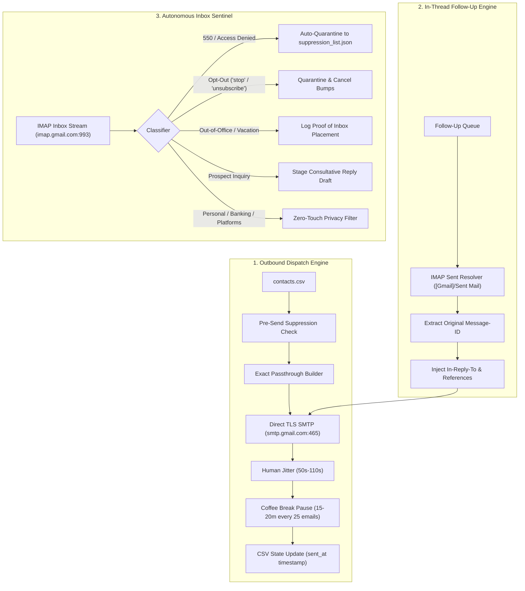

# 🛡️ Torret: Bulletproof Email Agent

> **Zero-dependency, human-paced cold outbound engine, native RFC 5322 in-thread follow-up resolver, and autonomous IMAP inbox sentinel with AI-powered 1-to-1 personalization.**

[](https://nodejs.org)
[](https://nodejs.org)
[](https://datatracker.ietf.org/doc/html/rfc5322)
[](https://opensource.org/licenses/MIT)

---

## 💡 Why This Exists

Most automated email senders trigger spam filters and ruin domain reputation because:
1. They fire emails in bulk bursts with machine-like regularity.
2. They embed tracking pixels, heavy HTML, and tracking redirects that corporate firewalls (Proofpoint, Mimecast, Microsoft Defender) flag as promotional or suspicious.
3. Follow-ups are sent as disjointed new messages instead of threading natively inside the original email conversation.
4. Bounces are ignored or handled manually, poisoning sender scores over time.

**Bulletproof Email Agent** solves this with a **zero-dependency, native TLS engine** that behaves exactly like a focused human sender while providing automated inbox monitoring, bounce quarantining, and threading.

---

## ⚡ Core Architecture



---

## ✨ Features

### 1. Human-Paced Dispatch (`index.js` + `mailer.js`)
* **Randomized Jitter:** Enforces a configurable 50s–110s pause between every individual email.
* **Automated Coffee Breaks:** Pauses for 15–20 minutes after every 25 emails to break up sending patterns.
* **Pure `text/plain` UTF-8:** Delivers 100% clean plain-text messages without HTML wrappers, tracking pixels, or third-party redirect links.
* **Exact Text Passthrough:** What you write is what gets sent—no unwanted automated rewriting or token mangling.
* **Instant State Persistence:** The target CSV updates to `status=sent` with ISO timestamps immediately after each message is delivered, eliminating double-sends.

### 2. Native In-Thread Follow-Up Engine (`thread_resolver.js`)
* Automatically connects to `[Gmail]/Sent Mail` via IMAP.
* Identifies your previous email to the prospect by recipient address and subject match.
* Injects RFC 5322 `In-Reply-To` and `References` headers so follow-up bumps land directly inside the recipient's existing conversation thread.

### 3. Autonomous Inbox Sentinel (`inbox_sentinel.js`)
* **Autonomous IMAP Scanner:** Inspects inbound messages without human intervention.
* **Bounce Quarantine:** Automatically extracts bounce reasons (550, user unknown, edge block) and commits bad addresses to `suppression_list.json`.
* **Pre-Send Verification:** The outbound sender checks `suppression_list.json` before every single send; quarantined addresses are skipped instantly.
* **Zero-Touch Privacy Boundary:** Automatically ignores personal, banking, social, shopping, and newsletter emails. Only monitors campaign prospects and DSN bounce notices.
* **Consultative Reply Staging:** Drafts non-salesy, value-first response templates for human review.

### 4. Terminal Analytics Dashboard (`view.js`)
* Real-time visual view of delivery metrics:
  * Total contacts in queue
  * Confirmed in-box deliveries
  * Bounce / failure rate
  * Pending queue status
  * Prospect reply count

---

## 📁 Repository Structure

```text
├── index.js               # CLI router, pacing logic, and dispatch queue
├── mailer.js              # Direct TLS SMTP client with RFC 5322 support
├── thread_resolver.js     # IMAP sent thread resolver for native follow-ups
├── inbox_sentinel.js      # Autonomous IMAP inbox monitor & bounce quarantine
├── view.js                # Terminal UI delivery & bounce dashboard
├── chain_orchestrator.js  # Multi-engine workflow orchestrator
├── generator.js           # Template and copy personalization utility
├── contacts.example.csv   # Template CSV demonstrating touch-1 and follow-ups
├── data/
│   └── .gitkeep           # Local directory for suppression lists and logs
├── .env.example           # Configuration template
├── .gitignore             # Strict exclusion of secrets and live prospect data
├── package.json           # Scripts and project metadata (Zero dependencies)
└── LICENSE                # MIT License
```

---

## 🚀 Quick Start

### 1. Requirements
* [Node.js](https://nodejs.org/) v18.0.0 or higher.
* **Google App Password:** A 16-character password generated at [Google Account App Passwords](https://myaccount.google.com/apppasswords) (requires 2-Step Verification enabled).
* **AI API Key (Optional):** Compatible with any standard LLM API (OpenAI, DeepSeek, Groq, Local Ollama). If omitted, Torret uses its built-in zero-dependency algorithmic structural generator.

### 2. Installation
Clone the repository:
```bash
git clone https://github.com/gana04982-ship-it/torret.git
cd torret
```
*(No `npm install` needed—this project uses 100% native Node.js standard libraries).*

### 3. Configuration
Copy the example environment file:
```bash
cp .env.example .env
```
Edit `.env` with your credentials:
```ini
GMAIL_USER=your_email@gmail.com
GMAIL_APP_PASSWORD=xxxx xxxx xxxx xxxx
AI_API_KEY=your_ai_api_key_here
AI_API_BASE=https://api.openai.com/v1
AI_MODEL=gpt-4o-mini
TEST_RECIPIENT=your_email@gmail.com

MIN_DELAY_SECONDS=50
MAX_DELAY_SECONDS=110
BATCH_SIZE=25
BREAK_MIN_MINUTES=15
BREAK_MAX_MINUTES=20
```

### 4. Prepare Your Contacts
Create `contacts.csv` (or copy from `contacts.example.csv`):
```csv
email,subject,body,status,sent_at,in_reply_to
john@examplefirm.com,"quick question re: case intake","Hi John,

Noticed your litigation depth across Texas.

We build custom automated workflows that streamline client intake and court docketing data entry.

Would you be open to a 5-minute conversation on how this works?

Best,
Ganesh",pending,,
```

---

## 💻 CLI Usage Guide

### Preview Without Sending (Dry Run)
Inspect every email, recipient, and formatted body before sending a single message:
```bash
npm run dry-run
# Or specify a custom CSV:
node index.js --dry-run --csv my_leads.csv
```

### Send a Test Email to Yourself
Send row 1 of your queue to your configured `TEST_RECIPIENT`:
```bash
npm run test-self
```

### View Live Delivery & Bounce Dashboard
Inspect IMAP delivery status, confirmed in-box placements, and bounces:
```bash
npm run view
# Or for a specific batch:
node index.js --view --csv contacts_batch1.csv
```

### Live Human-Paced Dispatch
Dispatch your outbound queue with random human jitter and automated coffee breaks:
```bash
npm start
# Or non-interactive:
node index.js --live --yes --csv contacts.csv
```

### Run Autonomous Inbox Sentinel
Scan for new prospect replies, parse out-of-office messages, and auto-quarantine bounces:
```bash
npm run sentinel
```

---

## 🔒 Security & Privacy Guarantees

* **Zero-Telemetry:** This codebase makes zero external calls to third-party tracking services, analytics endpoints, or external APIs. All traffic flows strictly between your machine and Google's official SMTP (`smtp.gmail.com:465`) and IMAP (`imap.gmail.com:993`) servers.
* **Never Commit Credentials:** `.env` and all live `contacts*.csv` files are explicitly blocked by `.gitignore`.
* **Isolated Data Storage:** Quarantine registries and suppression lists are stored in local JSON files that remain strictly on your local machine.

---

## 📄 License

This project is licensed under the [MIT License](LICENSE).
